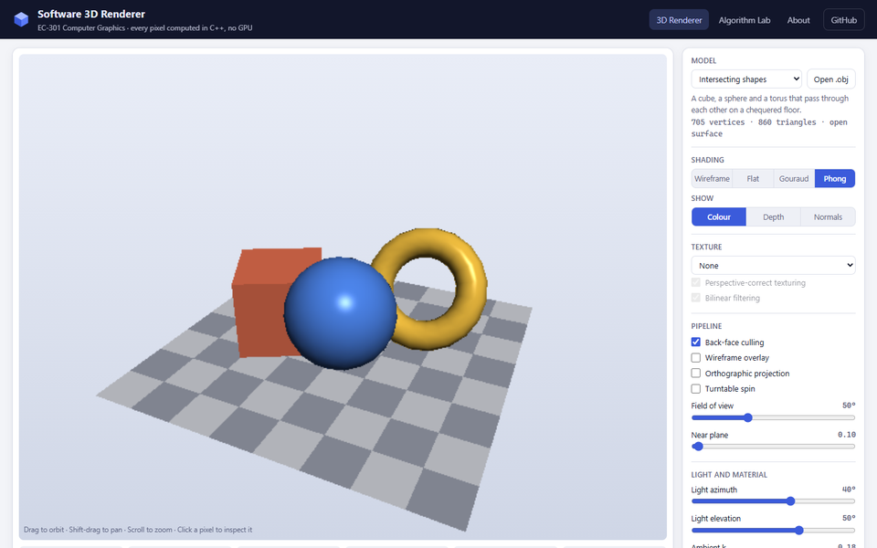
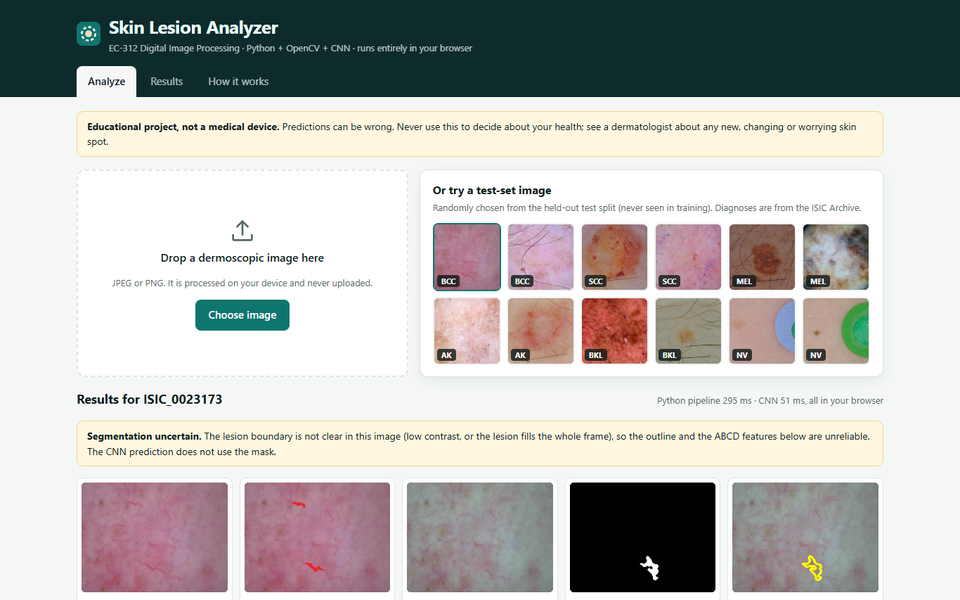
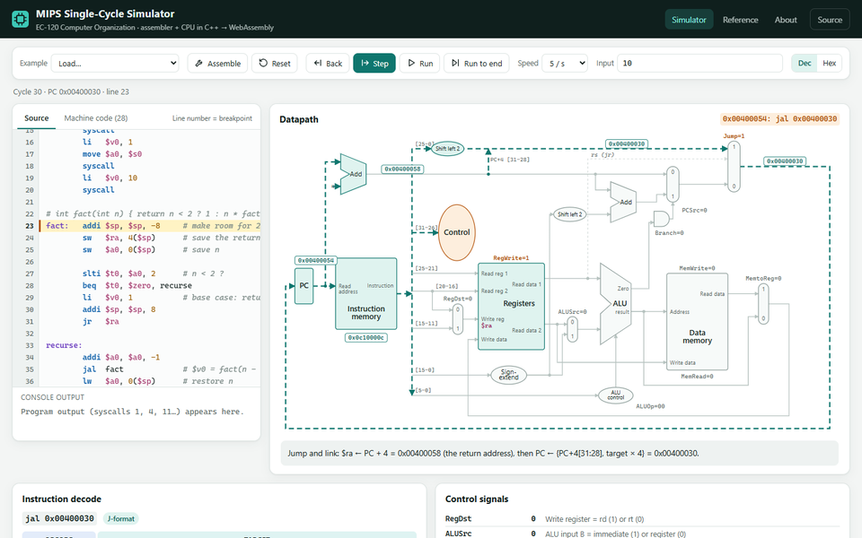
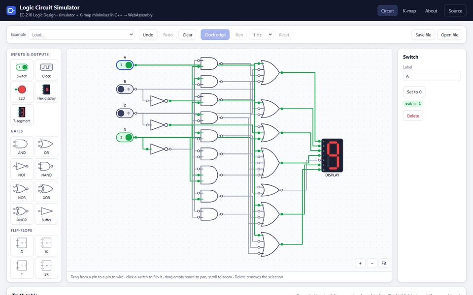
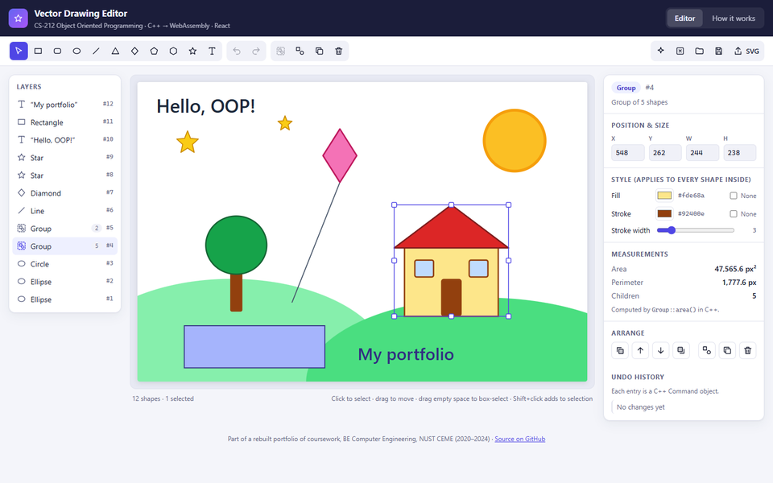
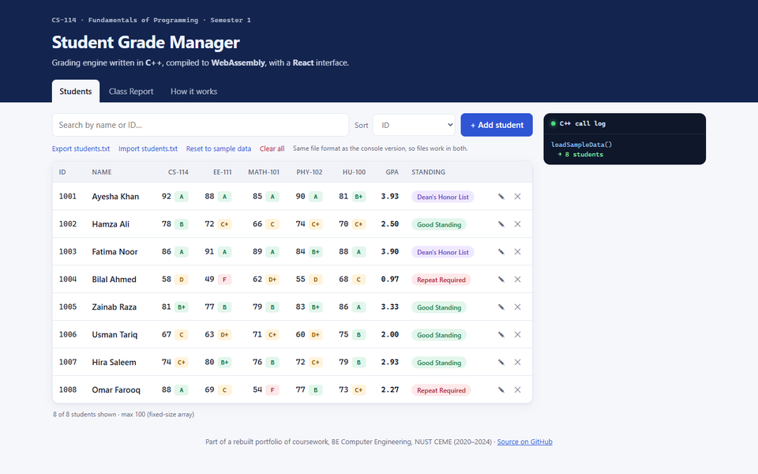

  

  
  
  
  
  
  
  
  
  

I'm a Computer Engineering graduate from **NUST College of Electrical & Mechanical Engineering** (BE, 2020–2024). I like building things from first principles: a 3D renderer that doesn't touch the GPU, a CPU you can watch execute instructions one clock cycle at a time, a logic simulator that minimises its own circuits.

**How I build:**
- The core of every project is plain **C++ or Python**, with unit tests.
- It's compiled to **WebAssembly**, so it runs entirely in your browser: no server, and nothing to install.
- Each project is one course from my degree, rebuilt as something you can open and use.

## Projects

<table>
  <tr>
    <td width="50%" valign="top">
      
      <h3>Software 3D Renderer</h3>
      
A complete rendering pipeline written from scratch, <b>with no GPU</b>:

      <ul>
        <li>clipping in homogeneous space;</li>
        <li>scan-line rasterisation and a z-buffer;</li>
        <li>flat, Gouraud and Phong shading;</li>
        <li>perspective-correct textures;</li>
        <li>a pixel inspector.</li>
      </ul>
      
It also has an algorithm lab that animates Bresenham, the midpoint circle, scan-line fill and clipping.

      <b>EC-301 Computer Graphics</b> · C++ → WebAssembly · React 
      <a href="https://github.com/tahirbuild/software-3d-renderer">Code</a>
    </td>
    <td width="50%" valign="top">
      
      <h3>Skin Lesion Analyzer</h3>
      
It segments a skin lesion in a dermoscopic image and classifies it into six classes, including <b>basal and squamous cell carcinoma</b>.

      <ul>
        <li>A classical image-processing pipeline (hair removal, Otsu thresholding, morphology).</li>
        <li>A MobileNetV3 CNN.</li>
        <li>Everything runs in the browser through Pyodide and ONNX Runtime.</li>
      </ul>
      <b>EC-312 Digital Image Processing</b> · Python · OpenCV · PyTorch · ONNX 
      <a href="https://github.com/tahirbuild/skin-lesion-analyzer">Code</a>
    </td>
  </tr>
  <tr>
    <td width="50%" valign="top">
      
      <h3>MIPS Single-Cycle Simulator</h3>
      
Write MIPS assembly, assemble it, and step through execution one clock cycle at a time. An animated datapath shows the value on every wire and every control signal.

      
It includes a two-pass assembler with pseudo-instructions, MARS-style syscalls and step-back.

      <b>EC-120 Computer Organization</b> · C++ → WebAssembly · React 
      <a href="https://github.com/tahirbuild/mips-simulator">Code</a>
    </td>
    <td width="50%" valign="top">
      
      <h3>Logic Circuit Simulator</h3>
      
Build circuits from gates and flip-flops and watch them simulate live, with truth tables and timing diagrams.

      <ul>
        <li>A K-map and Quine–McCluskey minimiser that shows its working, including Petrick's method.</li>
        <li>One click turns a minimised expression into a working circuit.</li>
      </ul>
      <b>EC-210 Logic Design</b> · C++ → WebAssembly · React 
      <a href="https://github.com/tahirbuild/logic-circuit-simulator">Code</a>
    </td>
  </tr>
  <tr>
    <td width="50%" valign="top">
      
      <h3>Vector Drawing Editor</h3>
      
Draw, group, restyle and reorder shapes, with unlimited undo and redo and SVG export.

      
It's an object-oriented C++ design: a polymorphic shape hierarchy, the Composite pattern for groups, and the Command pattern for undo.

      <b>CS-212 Object Oriented Programming</b> · C++ → WebAssembly · React 
      <a href="https://github.com/tahirbuild/vector-drawing-editor">Code</a>
    </td>
    <td width="50%" valign="top">
      
      <h3>Student Grade Manager</h3>
      
Stores student records, computes letter grades and credit-weighted GPA, and searches, sorts and saves them.

      
The same C++ builds a classic console program and a web app.

      <b>CS-114 Fundamentals of Programming</b> · C++ → WebAssembly · React 
      <a href="https://github.com/tahirbuild/student-grade-manager">Code</a>
    </td>
  </tr>
</table>

More coming, one per course: data structures, computer architecture (caches and pipelines), and more.

